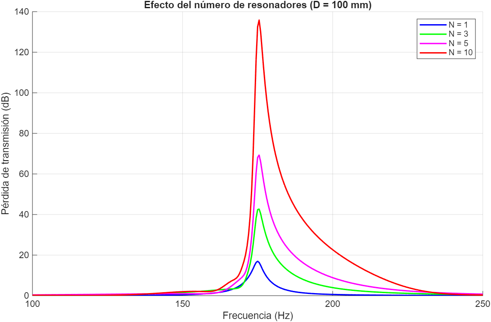
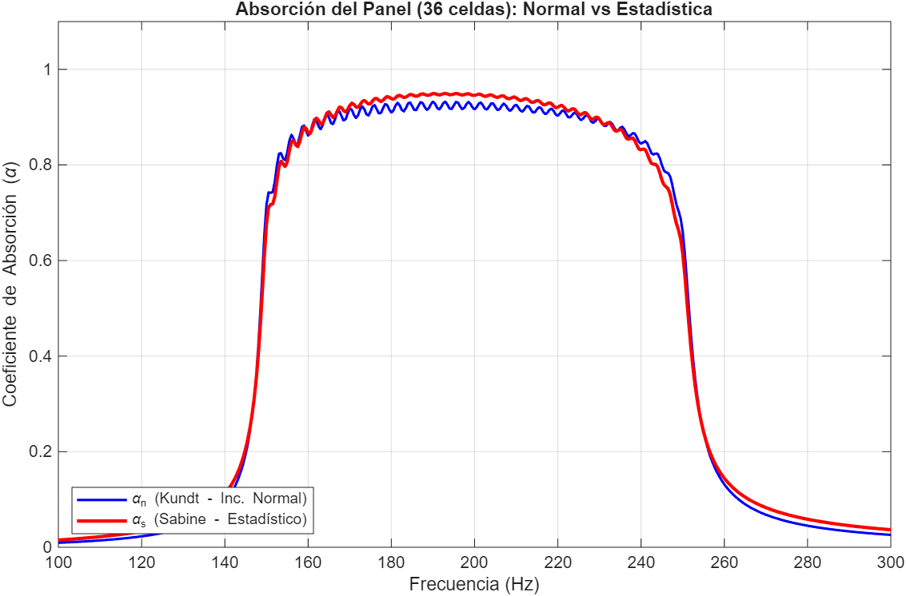

# 🔊 Broadband Acoustic Metamaterial Parametric Design

This repository contains the mathematical and geometric models developed for the design of an acoustic metamaterial oriented towards low-frequency absorption (bass trap). The system consists of a graded panel of 36 Helmholtz resonators, tuned to cover the modal range from **150 Hz to 250 Hz**.

This project is part of the Bachelor's Thesis (TFG) in **Sound and Image Engineering** at the **Universidad de Málaga**.

## 📊 1. Analytical Model (MATLAB)
The `/matlab` directory contains the scripts for calculating surface impedances, transmission loss and acoustic absorption.

The work includes **two simulations**:

### 1.1 Simulation A: Duct with resonators
A duct loaded with an array of Helmholtz resonators, evaluated with the Transfer Matrix Method. As illustrated below, increasing the number of resonators (N) significantly boosts the Transmission Loss (TL) around the target tuning frequency.

### 1.2 Simulation B: Graded cell panel
A 6x6 panel of resonator cells, each tuned to a different frequency within 150–250 Hz. The design is based on a locally reactive surface topology, evaluating absorption for both normal incidence (Kundt's Tube) and diffuse field (Paris Formula / Sabine Coefficient).

**Key results:**
* Average absorption greater than $\alpha = 0.9$ in the target design range.
* Thermal and viscous efficiency maximized through geometric compliance tuning.

## 📐 2. 3D Model (OpenSCAD)
The `/openSCAD` directory includes the geometry of the 36-cell panel (6x6 matrix, constant footprint, cavity depth adjusted according to the tuning vectors).

* **`resonator_36fields.stl`**: Full panel mesh.
* **`resonador_36fields_transversal.stl`**: Cross-section of the panel, showing the cavities and necks.

## 🛠️ 3. How to use this repository
1. **Simulation A (duct with resonators):** run `matlab/helmholtz_panel_tl.m` to compute the Transmission Loss for different numbers of resonators (N) and regenerate `tl_comparison_n_resonators.png`.
2. **Simulation B (cell panel):** run `matlab/helmholtz_panel_absorption.m` to compute the surface impedance and absorption of the graded panel.
3. **3D visualization:** open the `.stl` files in any mesh viewer or slicer.

---
**Author:** Pepe Castillo
**Project:** TrueSound / Bachelor's Thesis
